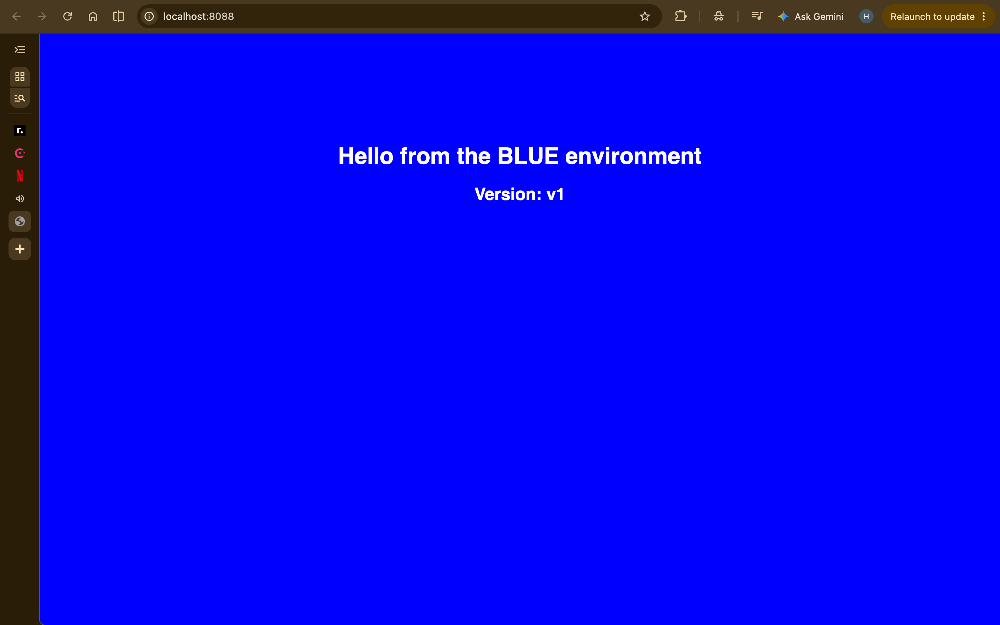
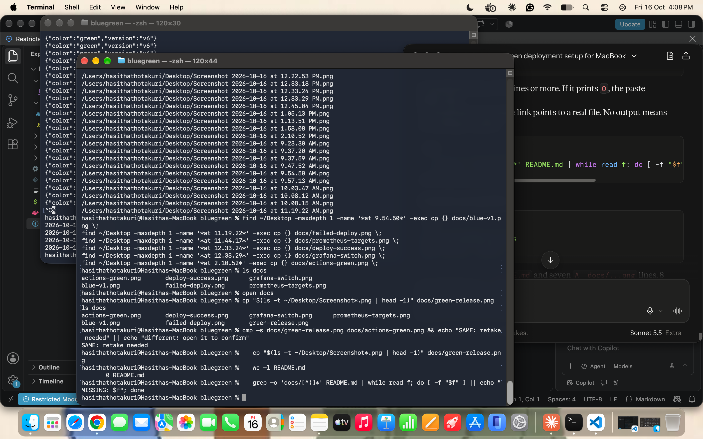
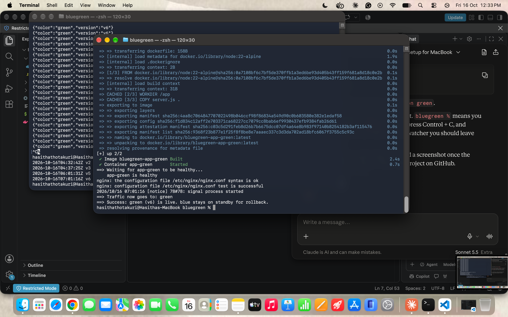
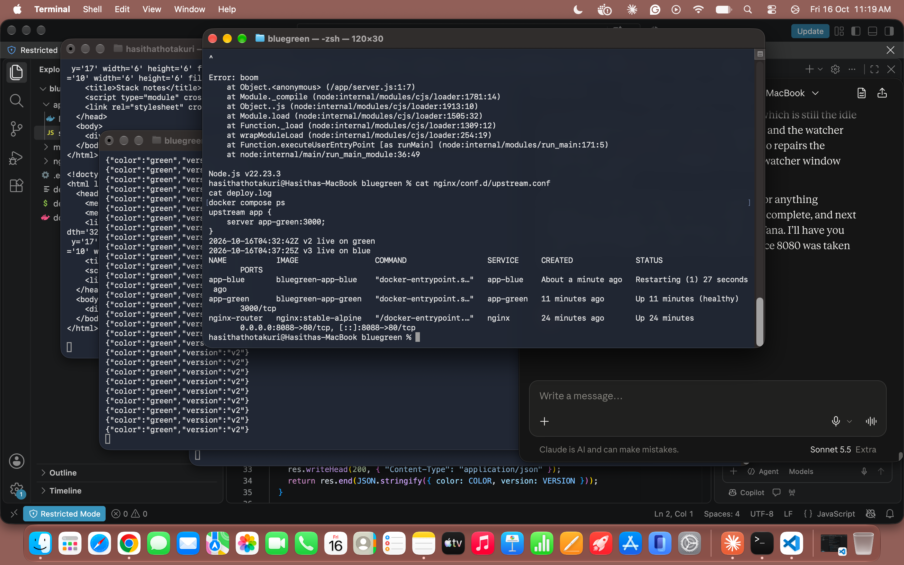
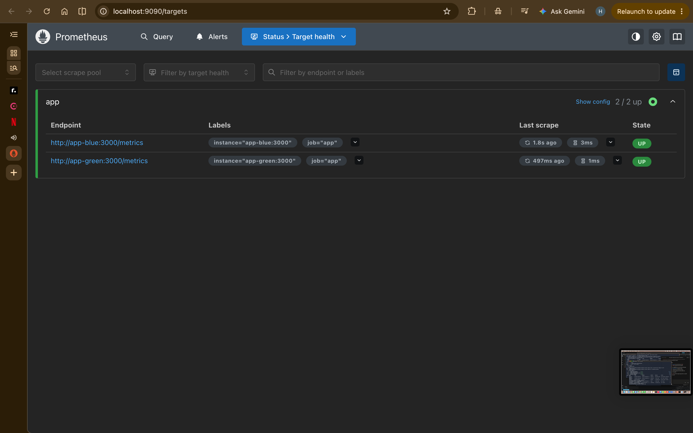
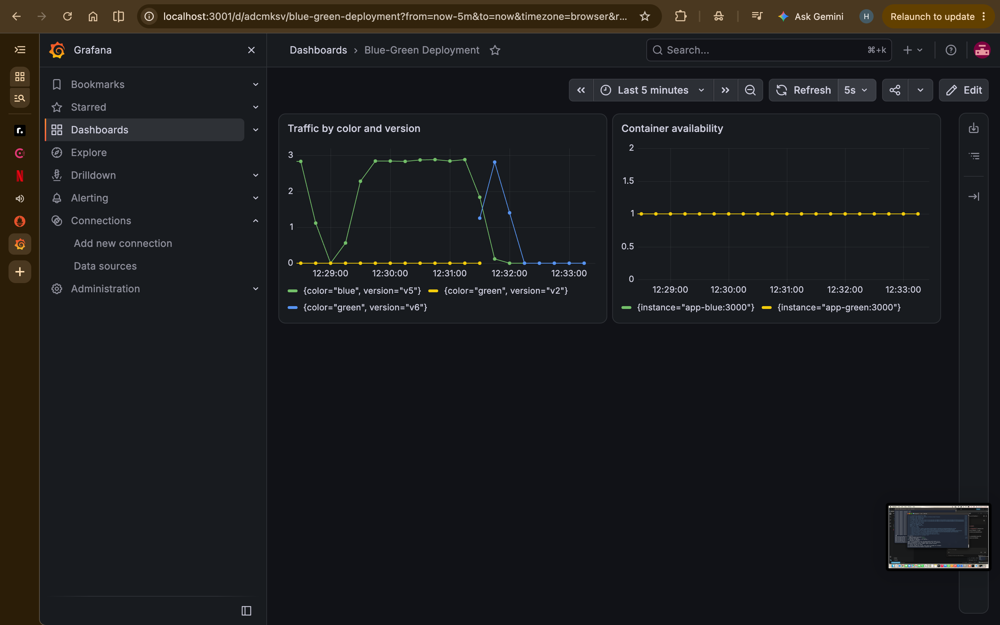
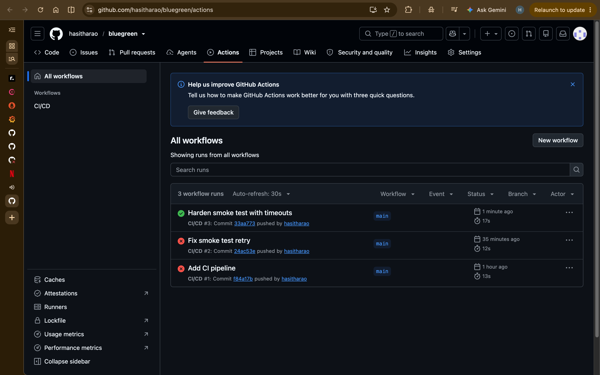

# Blue-Green Deployment

Zero-downtime releases for a small Node.js web app, using Docker Compose and Nginx. A new version is deployed to the idle environment, health-checked, and only then does traffic switch to it. The old version stays running so a rollback is instant.

Project from [roadmap.sh](https://roadmap.sh/projects/blue-green-deployment).

## Architecture

```
                    ┌──────────────┐
 Browser ─────────► │    Nginx     │  :8088
 localhost:8088     │ (the router) │
                    └──────┬───────┘
                           │ upstream.conf decides
              ┌────────────┴────────────┐
              ▼                         ▼
      ┌──────────────┐          ┌──────────────┐
      │  app-blue    │          │  app-green   │
      └──────────────┘          └──────────────┘
```

Only one color receives traffic. `nginx/conf.d/upstream.conf` points at it, and `deploy.sh` rewrites that file on each release.

## How a release works

1. `deploy.sh` reads `upstream.conf` to find which color is live.
2. It builds and starts the new version in the **idle** color only. Live traffic is untouched.
3. It waits for Docker's health check (`/health`) to pass. If it never does, the script aborts and users never notice.
4. It rewrites `upstream.conf`, validates it with `nginx -t`, and reloads Nginx gracefully, so in-flight requests finish normally.
5. It smoke-tests through the router and switches back automatically if that fails.
6. The previous color keeps running for instant rollback.

## Project structure

```
.
├── app/                    Node.js app and Dockerfile
├── nginx/nginx.conf        Router config (upstream.conf is generated)
├── monitoring/             Prometheus config
├── docker-compose.yml      app-blue, app-green, nginx, prometheus, grafana
├── deploy.sh               Deploy and rollback script
└── .github/workflows/      CI/CD pipeline
```

## Run it locally

Requirements: Docker Desktop, Git.

```bash
git clone https://github.com/hasitharao/bluegreen.git
cd bluegreen
./deploy.sh v1          # first run: starts everything, blue goes live
curl localhost:8088/version
```

Open http://localhost:8088 to see the page.

Release a new version and roll back:

```bash
./deploy.sh v2          # deploys to the idle color, then switches traffic
./deploy.sh rollback    # switches back to the previous color
```

App endpoints: `/` (page), `/version` (JSON), `/health` (health check), `/metrics` (Prometheus).

## Proof of zero downtime

Run this in one terminal while you deploy from another:

```bash
while true; do curl -sS localhost:8088/version; echo; sleep 0.3; done
```

The responses switch from `blue` to `green` with no errors in between.





## A failed release never reaches users

A deliberately broken version (`throw new Error("boom")`) was deployed. The new container crashed, the health check never passed, and the script stopped before touching Nginx. `upstream.conf` still pointed at the working color, and no traffic was lost.



## Monitoring

Prometheus (http://localhost:9090) scrapes `/metrics` from both containers every 5 seconds, and Grafana (http://localhost:3001) draws it. The `up` metric shows container availability, and `app_http_requests_total` shows which color and version serve traffic. Grafana assigns line colors automatically, so a green line is not necessarily the green environment. Read the legend.




Grafana setup: add a Prometheus data source with the URL `http://prometheus:9090`, then use these queries:

- Traffic: `sum by (color, version) (rate(app_http_requests_total[30s]))`
- Availability: `up{job="app"}`

## CI/CD

`.github/workflows/deploy.yml` runs on every push to `main`:

1. **test** validates the compose file, builds the image, and smoke-tests `/health`.
2. **deploy** connects over SSH to the server and runs `./deploy.sh <commit-sha>`. It is disabled by default and only runs when the repository variable `DEPLOY_ENABLED` is `true`.

To enable it, add the secrets `SSH_HOST`, `SSH_USER` and `SSH_KEY`, set `DEPLOY_ENABLED=true`, clone this repo to `~/bluegreen` on the server, and open TCP port 8088 in the server's firewall.



## Limitations and next steps

- Single-host blue-green. Both colors share one machine, so a host failure takes down both.
- Database schema changes must be backward compatible, because both versions run at the same time.
- No HTTPS yet. Put TLS in front of Nginx for production.
- The server builds the image itself. A container registry would let you build once and deploy the same image.
- SSH host keys are trusted on first use. Pin them in production.
- Secrets live in GitHub Actions secrets. A secret manager would be better at scale.